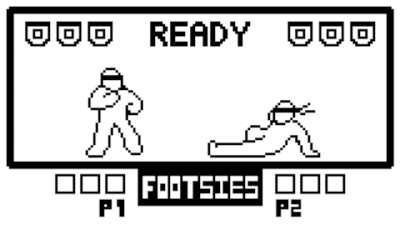
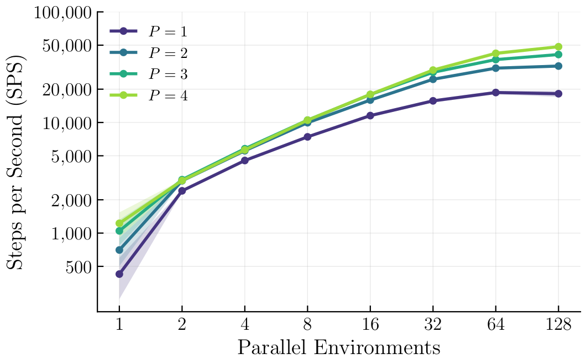
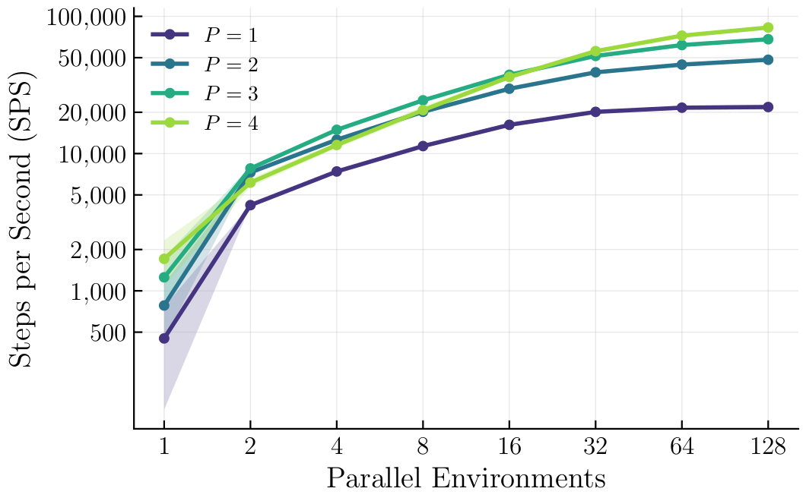
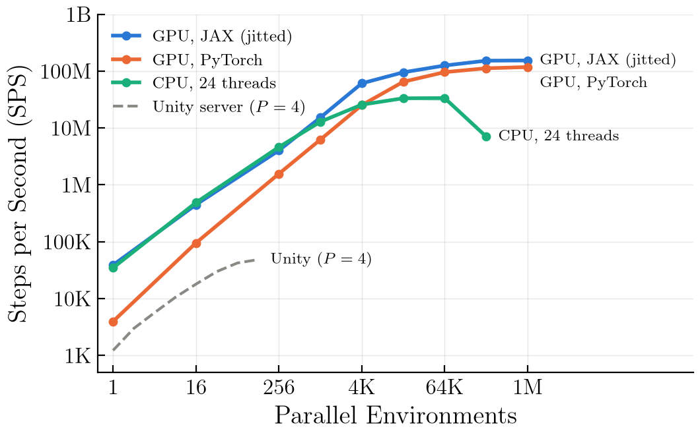

# FootsiesGym

<p align="left">
  <a href="https://github.com/como-research/FootsiesGym/actions/workflows/ci.yml"></a>
  <a href="https://arxiv.org/abs/2607.06514"></a>
  <a href="https://pypi.org/project/footsies-gym/"></a>
  <a href="https://pypi.org/project/footsies-gym/"></a>
  <a href="https://pepy.tech/project/footsies-gym"></a>
</p>

<p align="center">
  
</p>

FootsiesGym is a two-player zero-sum reinforcement learning benchmark. It uses the [Footsies](https://hifight.github.io/footsies/) fighting game by HiFight. For more data, refer to the paper: [FootsiesGym: A Fighting Game Benchmark for Two-Player Zero-Sum Imperfect-Information Games](https://arxiv.org/abs/2607.06514).

The environment is a PettingZoo `ParallelEnv`. It can run the game with one of two backends:

- **Unity** (default): the original game. The environment controls it through gRPC. FootsiesGym downloads the game binaries automatically.
- **C/CUDA**: a port of the game in C. Its results are bit-identical to the Unity game. It runs in the Python process, on the CPU or on an NVIDIA GPU.

## Documentation

| Topic | Location |
|-------|----------|
| Configuration, actions, observations, rewards, framework classes | [`footsiesgym/README.md`](footsiesgym/README.md) |
| C/CUDA backend: use, JAX training loops, design, tests | [`footsiesgym/c/README.md`](footsiesgym/c/README.md) |
| C source code | [`csrc/README.md`](csrc/README.md) |
| Unity game server: architecture, platforms, manual start | [`binaries/README.md`](binaries/README.md) |
| Training examples | [`experimentation/README.md`](experimentation/README.md) |
| Benchmark scripts | [`benchmarking/README.md`](benchmarking/README.md) |

## Installation

FootsiesGym needs Python 3.12 or newer. These steps use [uv](https://docs.astral.sh/uv/).

```bash
uv add footsies-gym                     # the Unity and C backends, numpy
uv add "footsies-gym[cuda]"             # also JAX on NVIDIA GPUs
```

To run the examples, tests and benchmarks of this repository:

```bash
git clone https://github.com/como-research/FootsiesGym.git
cd FootsiesGym
uv sync --all-extras                    # or select extras: uv sync --extra cuda --extra dev
```

| Extra | Contents | Necessary for |
|-------|----------|---------------|
| (none) | numpy, gRPC, PettingZoo | The Unity backend, the C backend on the CPU, `tensor_type="numpy"` |
| `jax` | JAX (CPU) | `tensor_type="jax"`, `functional=True` |
| `cuda` | JAX with CUDA (Linux) | JAX on an NVIDIA GPU |
| `dev` | pytest, black, isort, matplotlib, pandas | The tests, the benchmark figures |

Install other packages yourself: PyTorch for `tensor_type="torch"`, and `ray[rllib]` for `wrap_rllib`. For the dependencies of the training examples, refer to [`experimentation/README.md`](experimentation/README.md).

The C backend compiles its library on first use. It needs `gcc` or `clang`. For `device="cuda"`, it also needs the NVIDIA driver and `nvcc`.

## Quick Start

```python
import footsiesgym

env = footsiesgym.make()           # downloads and starts the game server

obs, infos = env.reset()
while True:
    actions = {agent: env.action_space(agent).sample() for agent in env.agents}
    obs, rewards, terminateds, truncateds, infos = env.step(actions)
    if terminateds["p1"] or truncateds["p1"]:
        obs, infos = env.reset()
```

With `num_envs > 1`, the environment runs many games at the same time. Each value is then an array, and its first axis has the length `num_envs`. When a game ends, `step()` starts a new game in its position:

```python
env = footsiesgym.make(num_envs=64)
```

## C/CUDA Backend

```python
env = footsiesgym.make(backend="c", num_envs=16384, num_threads=24)                      # CPU, numpy
env = footsiesgym.make(backend="c", num_envs=65536, device="cuda", tensor_type="torch")  # GPU, PyTorch
env = footsiesgym.make(backend="c", num_envs=4096, functional=True)                      # pure functions for jitted JAX loops
```

For more data, refer to [`footsiesgym/c/README.md`](footsiesgym/c/README.md).

## Configuration

Give the options to `make()` as keyword arguments or in a config dictionary:

| Key | Default | Description |
|-----|---------|-------------|
| `backend` | `"grpc"` | `"grpc"` (the Unity game server) or `"c"` |
| `num_envs` | `1` | Number of games that run at the same time |
| `tensor_type` | `"numpy"` | Type of the returned arrays: `"numpy"`, `"torch"` or `"jax"` |
| `device` | `"cpu"` | `"cpu"`, `"cuda"` or `"cuda:N"` (only for `backend="c"`) |
| `max_t` | `4000` | Number of steps in an episode before truncation |
| `frame_skip` | `4` | Number of game frames in each step |
| `action_delay` | `8` | Number of frames before a selected action starts |
| `headless` | `True` | Runs the Unity server headless or in a window (only for `backend="grpc"`) |

For all options, and for the actions, observations and rewards, refer to [`footsiesgym/README.md`](footsiesgym/README.md).

### Rendering

Only the Unity backend can render. Set `headless=False` to show the game in a window. With `backend="c"`, this setting raises an error.

```python
env = footsiesgym.make(headless=False)
```

To watch at game speed, wait `frame_skip / 60` seconds between steps, as in [`play_unity.py`](experimentation/experiments/cleanrl/play_unity.py).

## Throughput

<table align="center">
  <tr>
    <td align="center" width="50%"></td>
    <td align="center" width="50%"></td>
  </tr>
  <tr>
    <td align="center"><b>Linux</b></td>
    <td align="center"><b>macOS</b></td>
  </tr>
</table>

The figures show the Unity backend: environment steps per second for each value of `num_envs`, with $P$ game-server processes in parallel.

<p align="center">
  
</p>

The second figure shows the C backend on one RTX 3090 and on the 24 cores of a Threadripper 3960X. On the GPU, jitted JAX gives approximately 154M steps per second with 1M games. PyTorch gives approximately 118M. On the CPU, the C backend gives approximately 33M steps per second with 16K to 64K games. With more games, the data does not fit in the CPU cache, and the speed decreases. The dashed line is the best Unity configuration.

To get these results again, refer to [`benchmarking/`](benchmarking/). The benchmarks need the `dev` extra.

## Development

```bash
uv sync --all-extras
uv run pytest -m "not slow"   # the fast tests
uv run pytest                 # all tests: the slow tests start the Unity game server
uv build                      # the wheel and the source distribution
```

If an extra or a GPU is not available, pytest skips the tests that need it. For the tests of the C backend, refer to [`footsiesgym/c/README.md`](footsiesgym/c/README.md#tests).

## Citation

```bibtex
@article{mcdonald2026footsiesgym,
  title={FootsiesGym: A Fighting Game Benchmark for Two-Player Zero-Sum Imperfect-Information Games},
  author={McDonald, Chase and Tsang, Nathan and Kerr, Wesley N},
  journal={arXiv preprint arXiv:2607.06514},
  year={2026}
}
```

## License

[GNU General Public License v3.0](LICENSE.txt). FootsiesGym is based on the open-source [Footsies](https://github.com/hifight/Footsies) game by HiFight.
