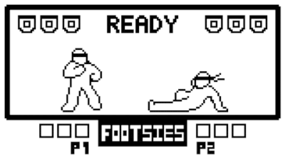
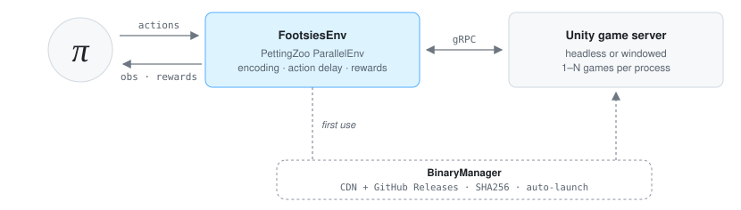
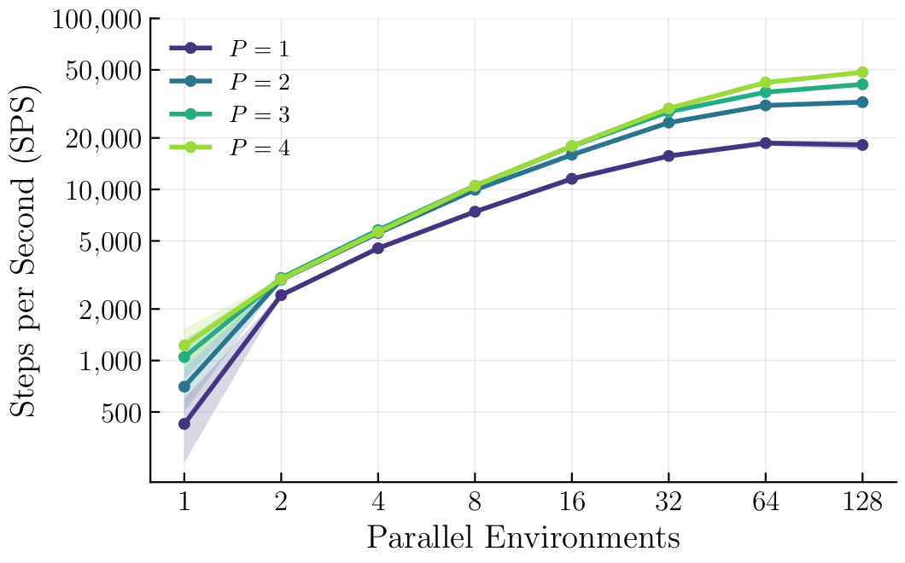
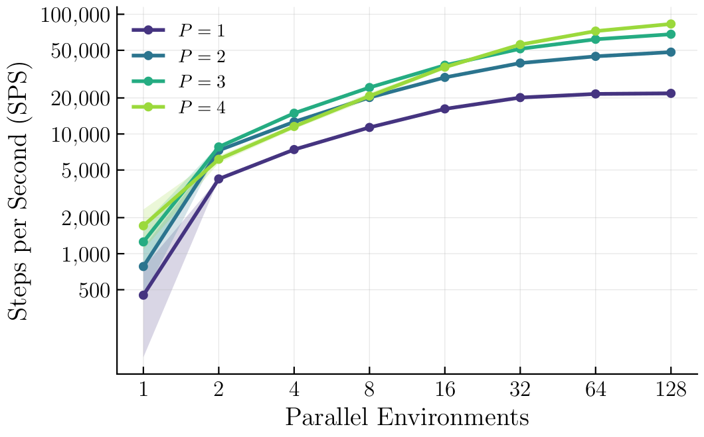
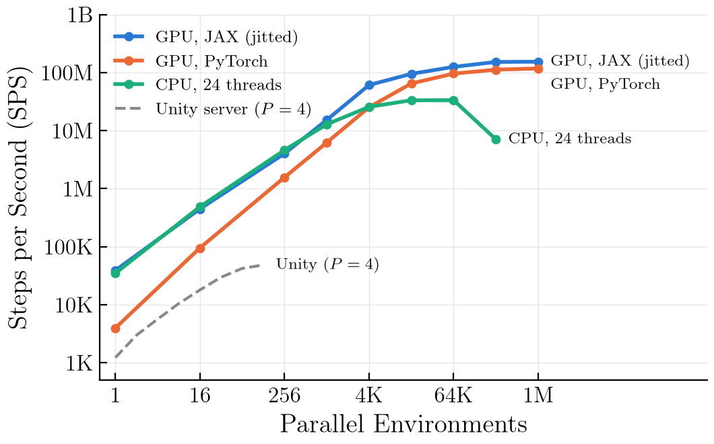

# FootsiesGym

<p align="left">
  <a href="https://arxiv.org/abs/2607.06514"></a>
  <a href="https://pypi.org/project/footsies-gym/"></a>
  <a href="https://pepy.tech/project/footsies-gym"></a>
</p>

<p align="center">
  
</p>

FootsiesGym is a two-player zero-sum reinforcement learning benchmark. It uses the [Footsies](https://hifight.github.io/footsies/) fighting game by HiFight. For more data, refer to the paper: [FootsiesGym: A Fighting Game Benchmark for Two-Player Zero-Sum Imperfect-Information Games](https://arxiv.org/abs/2607.06514).

The environment is a PettingZoo `ParallelEnv`. It can run the game with one of two backends:

- **Unity** (default): the original game. The environment controls it through gRPC. FootsiesGym downloads the game binaries automatically.
- **C/CUDA**: a port of the game in C. Its results are bit-identical to the Unity game. It runs in the Python process, on the CPU or on an NVIDIA GPU.

## Installation

FootsiesGym needs Python 3.12 or newer. These steps use [uv](https://docs.astral.sh/uv/). uv installs the correct Python version and all of the dependencies.

### Use FootsiesGym in your project

```bash
uv add footsies-gym                     # the Unity and C backends, numpy
uv add "footsies-gym[cuda]"             # also JAX on NVIDIA GPUs
```

### Run the examples, tests and benchmarks of this repository

1. Install uv:

   ```bash
   curl -LsSf https://astral.sh/uv/install.sh | sh
   ```

2. Get the source code:

   ```bash
   git clone https://github.com/como-research/FootsiesGym.git
   cd FootsiesGym
   ```

3. Install FootsiesGym and the extras that you need (refer to the table below). For example, for the JAX training example on a GPU:

   ```bash
   uv sync --extra cuda --extra jax-training --extra dev
   ```

   To install all of the extras, use `uv sync --all-extras`.

4. Run all commands with `uv run`. uv uses the environment of the project (`.venv`):

   ```bash
   uv run python -c "import footsiesgym; print(footsiesgym.make(backend='c').reset()[0]['p1'].shape)"
   ```

| Extra | Contents | Necessary for |
|-------|----------|---------------|
| (none) | numpy, gRPC, PettingZoo | The Unity backend, the C backend on the CPU, `tensor_type="numpy"` |
| `jax` | JAX (CPU) | `tensor_type="jax"`, `functional=True` |
| `cuda` | JAX with CUDA (Linux) | JAX on an NVIDIA GPU |
| `jax-training` | `jax`, Flax, Optax | The JAX training example |
| `training` | PyTorch, Weights & Biases | `tensor_type="torch"`, the PyTorch training example |
| `rllib` | Ray RLlib, PyTorch | The RLlib examples, `wrap_rllib` |
| `dev` | pytest, black, isort, matplotlib, pandas | The tests, the benchmark figures |

The C backend compiles its library on first use. Thus, it needs a C compiler (`gcc` or `clang`). For `device="cuda"`, it also needs the NVIDIA driver and `nvcc` from the CUDA toolkit. FootsiesGym finds `nvcc` through `$CUDA_HOME`, `PATH` or `/usr/local/cuda`.

## Quick Start

```python
import footsiesgym

env = footsiesgym.make()           # downloads and starts the game server

obs, infos = env.reset()
while True:
    actions = {agent: env.action_space(agent).sample() for agent in env.agents}
    obs, rewards, terminateds, truncateds, infos = env.step(actions)
    if terminateds["p1"] or truncateds["p1"]:
        obs, infos = env.reset()
```

With `num_envs > 1`, the environment runs many games at the same time. Each value is then an array, and its first axis has the length `num_envs`. When a game ends, `step()` starts a new game in its position:

```python
env = footsiesgym.make(num_envs=64)
```

The C backend runs the same game without binaries, on the CPU or on a CUDA GPU (refer to [C/CUDA Backend](#ccuda-backend)). The `tensor_type` setting selects the type of arrays that all backends return:

```python
env = footsiesgym.make(backend="c", num_envs=65536, device="cuda", tensor_type="torch")
obs, infos = env.reset()                   # obs["p1"]: torch.float32 (65536, 88) on cuda:0
obs, rewards, terminateds, truncateds, infos = env.step({"p1": a1, "p2": a2})
```

For JAX, use `functional=True`. Then `make()` returns the environment as pure functions of an explicit state. JAX can compile all of the rollout into one jitted program. The program runs on the default JAX device. For more data, refer to [Jitted JAX training loops](#jitted-jax-training-loops).

```python
import jax
import footsiesgym

env = footsiesgym.make(backend="c", num_envs=4096, functional=True)

@jax.jit
def rollout(key):
    obs, state, infos = env.reset(key)

    def step(carry, key):
        state, obs = carry
        k1, k2 = jax.random.split(key)
        actions = {                                   # replace with your policy
            "p1": jax.random.randint(k1, (env.num_envs,), 0, env.action_dim),
            "p2": jax.random.randint(k2, (env.num_envs,), 0, env.action_dim),
        }
        obs, state, rewards, terminateds, truncateds, infos = env.step(key, state, actions)
        return (state, obs), rewards["p1"]

    _, rewards = jax.lax.scan(step, (state, obs), jax.random.split(key, 1000))
    return rewards                                    # (1000, 4096)

rewards = rollout(jax.random.key(0))
```

## Architecture

<p align="center">
  <picture>
    <source media="(prefers-color-scheme: dark)" srcset="assets/architecture-dark.svg">
    
  </picture>
</p>

The solid arrows show the data flow at each step. The dotted arrows occur one time only, on first use. Each `step()` moves the game forward by `frame_skip` frames. With `num_envs > 1`, one batched gRPC call moves all of the games forward.

## Configuration

Each option is a config key. You can give the options in a config dictionary, as keyword arguments, or both. For example, use `footsiesgym.make(config={...})` or `footsiesgym.make(num_envs=64)`. FootsiesGym merges the two. If you set one key to two different values, FootsiesGym shows an error.

| Key | Default | Description |
|-----|---------|-------------|
| `backend` | `"grpc"` | `"grpc"` (the Unity game server) or `"c"` (the [C port](#ccuda-backend), in the Python process) |
| `num_envs` | `1` | Number of games that run at the same time (vectorized mode when the value is more than 1) |
| `tensor_type` | `"numpy"` | Type of the returned arrays: `"numpy"`, `"torch"` or `"jax"`. Actions can be any of the three types. |
| `device` | `"cpu"` | `"cpu"`, `"cuda"` or `"cuda:N"` (only for `backend="c"`) |
| `num_threads` | all cores | Number of CPU threads for `backend="c"` on the CPU. One thread for each physical core gives the best speed. |
| `max_t` | `4000` | Number of steps in an episode before truncation |
| `frame_skip` | `4` | Number of game frames in each step |
| `action_delay` | `8` | Number of frames before a selected action starts. The value must be a multiple of `frame_skip`. |
| `use_special_charge_action` | `False` | Adds the special-charge toggle actions (6 to 8) |
| `win_reward_scaling_coeff` | `1.0` | Size of the win and loss reward |
| `guard_break_reward` | `0.0` | Reward for each guard break |
| `use_reward_budget` | `False` | Subtracts guard-break rewards from the win reward |
| `return_fight_state_in_infos` | `False` | Adds fight-state data to `infos` (single-game mode only) |
| `headless` | `True` | Runs the Unity server headless or in a window |
| `port`, `host` | automatic, `"localhost"` | gRPC address of the Unity server |
| `platform` | `"linux"` | `"linux"` or `"mac"` (Unity server) |
| `launch_binaries` | `True` | Starts the Unity server automatically |
| `functional` | `False` | Returns pure JAX `reset` and `step` functions for jitted loops (`backend="c"`, refer to [Jitted JAX training loops](#jitted-jax-training-loops)) |

### Framework classes

Some frameworks make the environment themselves. These frameworks need a class, not an environment object. `footsiesgym.make_class(...)` accepts the same settings as `make()`. It returns a class, and each instance of the class is the object that `make()` returns. When the framework makes an instance, FootsiesGym merges the framework configuration with the settings of the class. If one key has two different values, FootsiesGym shows an error.

The `functional` setting selects the type of class. Each class has the class attribute `possible_agents` (`["p1", "p2"]`).

```python
Cls = footsiesgym.make_class(backend="c", num_envs=64)            # FootsiesEnv subclass: Cls(**more_settings)

FootsiesEnv = footsiesgym.make_class(backend="c", functional=True)  # Sardine: Cls(**env_config).vectorize(n)
Experiment().environment(env=FootsiesEnv, env_config={"max_t": 4000}, num_envs=4096)
```

`FootsiesEnv` uses the PettingZoo `ParallelEnv` API. RLlib uses its own `MultiAgentEnv` class, which has an API that is almost the same. Use `footsiesgym.wrappers.wrap_rllib` to make the environment usable in RLlib. The wrapper accepts a single-game environment or a vectorized environment. For a vectorized environment, the agents of game `i` are `p1_i` and `p2_i`. The wrapper needs `tensor_type="numpy"` on the CPU.

```python
from ray import tune
from footsiesgym.wrappers import wrap_rllib

tune.register_env("footsies", lambda cfg: wrap_rllib(footsiesgym.make(cfg)))
config.environment("footsies", env_config={"backend": "c", "num_envs": 64})
```

## Actions

Each agent selects one action from `Discrete(6)`. With `use_special_charge_action=True`, the agent selects one action from `Discrete(9)`.

| ID | Action | ID | Action |
|----|--------|----|--------|
| 0 | `NONE` | 5 | `FORWARD_ATTACK` |
| 1 | `BACK` | 6 | `SPECIAL_CHARGE` |
| 2 | `FORWARD` | 7 | `FORWARD_SPECIAL_CHARGE` |
| 3 | `ATTACK` | 8 | `BACK_SPECIAL_CHARGE` |
| 4 | `BACK_ATTACK` | | |

- **Special charge.** For a special attack, the agent must hold the attack button for 60 frames. At `frame_skip=4`, this is 15 steps. A `SPECIAL_CHARGE` action holds the attack button. While the button is held, the movement actions change to their attack versions (`FORWARD` changes to `FORWARD_ATTACK`). A second `SPECIAL_CHARGE` action releases the button.
- **Action delay.** An action starts `action_delay // frame_skip` steps after the agent selects it. This delay simulates reaction time.

## Observations

Each agent gets a `Box` with the shape `(88,)`:

| Part | Size | Contents |
|------|------|----------|
| Common | 1 | Distance between the players |
| Self | 50 | 37 public features (position, velocity, health, guard, action state) and 13 private features: dash readiness (2), special-attack progress (1), previous action (9), charge state (1) |
| Opponent | 37 | Public features only |

## Rewards

The rewards are zero-sum (`rewards["p1"] + rewards["p2"] == 0`):

| Event | Reward |
|-------|--------|
| The opponent dies | `± win_reward_scaling_coeff` |
| The guard of the opponent breaks | `± guard_break_reward` (a maximum of 3 times in each episode) |

With `use_reward_budget=True`, FootsiesGym subtracts the guard-break rewards from the win reward. Thus, the total reward of an episode is never more than `win_reward_scaling_coeff`.

## C/CUDA Backend

`backend="c"` runs a port of the game in C, in the Python process. It runs on the CPU or on a CUDA GPU. Its observations, rewards and done flags are bit-identical to the Unity game. Thus, a policy that you train with the C backend plays the same in the real game.

The C backend does not need the game server. It needs a C compiler, because FootsiesGym compiles the library on first use. For the GPU, it also needs `nvcc`. FootsiesGym finds `nvcc` through `$CUDA_HOME`, `PATH` or `/usr/local/cuda`.

```python
# CPU, numpy
env = footsiesgym.make(backend="c", num_envs=16384, num_threads=24)

# GPU, PyTorch: the observations and rewards stay on the GPU
env = footsiesgym.make(backend="c", num_envs=65536, device="cuda", tensor_type="torch")
obs, infos = env.reset()
actions = {"p1": policy(obs["p1"]), "p2": opponent(obs["p2"])}   # torch tensors on cuda:0
obs, rewards, terminateds, truncateds, infos = env.step(actions)
```

- The API is the same as the API of the Unity backend. With `num_envs=1`, the environment is a single-game PettingZoo environment. With more games, each value is an array, and its first axis has the length `num_envs`.
- When a game ends, `step` starts a new game in its position. The returned observations come from the new game. The rewards and done flags come from the episode that ended.
- Each `step` returns new arrays. Thus, you can keep the arrays from one step after the next step.
- The actions can be numpy, torch or JAX arrays. If the actions are on the GPU of the environment, they stay on the GPU.
- The rewards are float32 values.
- On the CPU, one thread for each physical core gives the best speed. Set this number with `num_threads`.

For the design of the C backend and its tests, refer to [`footsiesgym/c/README.md`](footsiesgym/c/README.md).

### Jitted JAX training loops

Sardine's Anakin setup compiles all of the rollout into one jitted program. For this setup, use `functional=True`. Then `make()` returns the environment step as pure functions of an explicit state. The functions run on the JAX device: `jax.default_device`, or the device of the jitted function.

```python
f = footsiesgym.make(backend="c", num_envs=4096, functional=True)   # Sardine's functional API

@jax.jit
def rollout(key):
    obs, state, infos = f.reset(key)
    def body(state, key):
        actions = ...                     # from your policy
        obs, state, rewards, terminateds, truncateds, infos = f.step(key, state, actions)
        return state, rewards
    return jax.lax.scan(body, state, jax.random.split(key, 128))
```

`step` starts new games when games end. `step_env` does not start new games. `state.t` and `state.episode_id` are arrays with the shape `(num_envs,)`.

Sardine makes the environment from a class (`Cls(**env_config).vectorize(num_envs)`). `make_class` returns this class (refer to [Framework classes](#framework-classes)):

```python
from sardine.experiment import Experiment

FootsiesEnv = footsiesgym.make_class(backend="c", functional=True, frame_skip=4)
Experiment().environment(env=FootsiesEnv, env_config={"max_t": 4000}, num_envs=4096)
```

## Game Server

The Unity backend downloads, verifies and starts the game server automatically. To start a server manually, or for the supported platforms and the download locations, refer to [`binaries/README.md`](binaries/README.md).

## Training

> [!NOTE]
> The code for the experiments of the paper is not available yet. The examples that follow are not the code for those experiments.

- **CleanRL** ([PPO examples](experimentation/experiments/cleanrl/), each in one file):
  - JAX on the C/CUDA environment. All of the training runs on the GPU. A second script plays the trained policy in the Unity game and compares Unity with the C environment.
  - PyTorch on the Unity game server.

  ```bash
  uv sync --extra cuda --extra jax-training
  uv run python -m experimentation.experiments.cleanrl.train_ppo_jax
  uv run python -m experimentation.experiments.cleanrl.play_unity --policy runs/ppo_jax/policy.msgpack
  ```

- **RLlib** ([APPO](https://docs.ray.io/en/latest/rllib/rllib-algorithms.html#appo)). You can use the RLModule stack (recommended) or the legacy ModelV2 stack:

  ```bash
  uv sync --extra rllib --extra training
  uv run python -m experimentation.experiments.rllib.train_rlmodule --experiment-name <name> [--debug]
  uv run python -m experimentation.experiments.rllib.train --experiment-name <name>
  ```

## Throughput

<table align="center">
  <tr>
    <td align="center" width="50%"></td>
    <td align="center" width="50%"></td>
  </tr>
  <tr>
    <td align="center"><b>Linux</b></td>
    <td align="center"><b>macOS</b></td>
  </tr>
</table>

The figures show the Unity backend: environment steps per second for each value of `num_envs`, with $P$ game-server processes in parallel.

<p align="center">
  
</p>

The second figure shows the C backend on one RTX 3090 and on the 24 cores of a Threadripper 3960X. On the GPU, jitted JAX gives approximately 154M steps per second with 1M games. PyTorch gives approximately 118M. On the CPU, the C backend gives approximately 33M steps per second with 16K to 64K games. With more games, the data does not fit in the CPU cache, and the speed decreases. The dashed line is the best Unity configuration.

To get these results again, refer to [`benchmarking/`](benchmarking/). The benchmarks need the `dev` extra.

## Development

```bash
uv sync --all-extras
uv run pytest -m "not slow"   # the fast tests
uv run pytest                 # all tests: the slow tests start the Unity game server
uv build                      # the wheel and the source distribution
```

If an extra or a GPU is not available, pytest skips the tests that need it. For the tests of the C backend, refer to [`footsiesgym/c/README.md`](footsiesgym/c/README.md#tests).

## Citation

```bibtex
@article{mcdonald2026footsiesgym,
  title={FootsiesGym: A Fighting Game Benchmark for Two-Player Zero-Sum Imperfect-Information Games},
  author={McDonald, Chase and Tsang, Nathan and Kerr, Wesley N},
  journal={arXiv preprint arXiv:2607.06514},
  year={2026}
}
```

## License

[GNU General Public License v3.0](LICENSE.txt). FootsiesGym is based on the open-source [Footsies](https://github.com/hifight/Footsies) game by HiFight.
